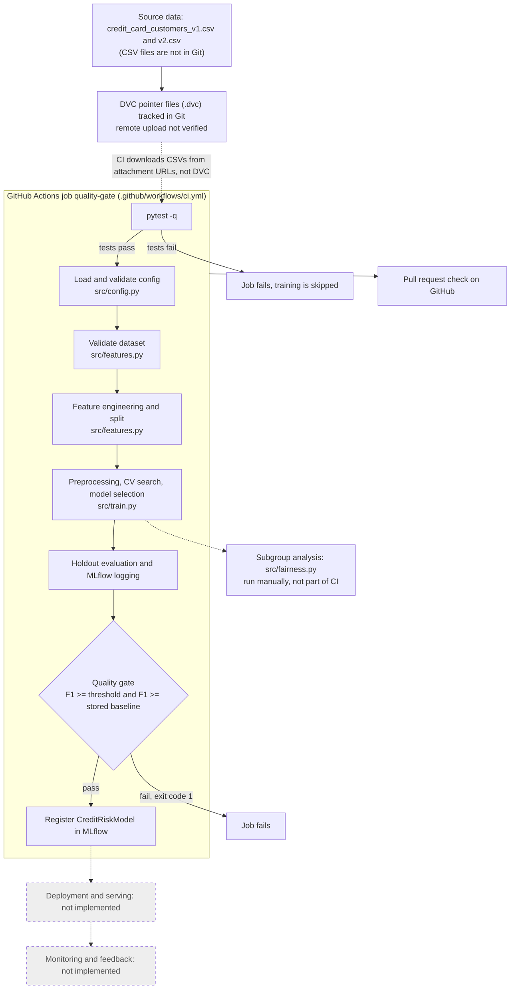

# Credit Risk Prediction with an MLOps CI/CD Quality Gate

Status of this document: written on 25 October 2026 from the GitHub repository (branch `master`) and the three demonstration pull requests. Items marked "(verify)" could not be confirmed from the repository and need to be checked locally by the team before submission.

## A. Overview

### Problem

The project predicts whether a credit-card customer is high risk. The target column is `High_Risk_Customer` (binary, 0/1). Inputs are account and behaviour fields such as age, income bracket, credit limit, current balance, monthly spend, number of monthly transactions, payment delay in days and tenure in months. The identifier column `Customer_ID` is never used as a predictor.

### Purpose of the pipeline

The pipeline loads a versioned dataset, validates it, engineers features, tunes and compares three model families, evaluates the selected model on a held-out split, tracks the runs in MLflow, and then checks the result against a quality gate. The same code runs locally and in GitHub Actions.

### Why MLOps and a quality gate

A model can get worse without any code being wrong: the data changes, a hyperparameter grid changes, or a threshold is edited. Ordinary unit tests do not catch that. The quality gate compares each candidate model with a stored baseline (`baseline.json`) and with an absolute floor, and fails the CI job when the candidate is worse. This is the main idea the project demonstrates.

### Scope and limitations

This is an MSc student project on a small offline dataset. It is a reproducible training and CI quality-gate workflow. It is not deployed anywhere, there is no serving endpoint, and there is no production monitoring. It must not be used for real lending decisions. See section L for the full list of limitations.

## B. Contributors

| Name | Roll No. |
|---|---|
| Pranav Nair | B003 |
| Sidhesh Mohanty | B017 |

Programme: M. Sc. in Data Science. Specialization: Data Science. Division: B.

## C. System architecture

The diagram shows what exists in the repository. Dashed grey boxes are not implemented.



Reading the diagram: a push or pull request starts the workflow. Tests run first. If they pass, `src/train.py` runs with `configs/ci.yaml`, and the quality gate decides whether the step exits with code 0 or 1. Model registration happens inside the training run and only when the gate passes.

## D. Repository structure

Verified from the GitHub repository on `master`:

```
.
├── .dvc/
│   └── config                       DVC remote definition (name: gdrive_remote)
├── .dvcignore
├── .github/workflows/ci.yml         CI workflow: tests, then training and quality gate
├── .gitignore
├── baseline.json                    Stored baseline metrics used by the quality gate
├── configs/
│   ├── base.yaml                    Full configuration (5-fold CV, full grids)
│   └── ci.yaml                      Lightweight configuration for CI (2-fold CV, one grid point)
├── credit_card_customers_v1.csv.dvc DVC pointer for dataset v1
├── credit_card_customers_v2.csv.dvc DVC pointer for dataset v2
├── requirements.txt
├── src/
│   ├── config.py                    Pydantic configuration schema and load_config
│   ├── features.py                  Dataset validation and feature engineering
│   ├── train.py                     Training, tuning, evaluation, quality gate, MLflow
│   └── fairness.py                  Subgroup metrics for age group and income bracket
└── tests/
    ├── test_config.py
    ├── test_features.py
    ├── test_fairness.py
    ├── test_quality_gate.py
    └── test_train.py
```

To be added by the team (not yet in the repository): `README.md` and `docs/lifecycle_map.md`.

Present only on a developer machine (ignored by Git, see `.gitignore`): `credit_card_customers_v1.csv`, `credit_card_customers_v2.csv`, `artifacts/`, `mlflow.db`, `mlruns/`, `.venv/`, `.venv312/`.

The GitHub directory listings for `src/` and `tests/` could not be fetched, so the files above are the ones whose contents were read directly. If those folders contain other files (for example `src/__init__.py`), add them here (verify).

| Path | Purpose |
|---|---|
| [src/config.py](src/config.py) | Defines the configuration schema with strict validation and loads YAML |
| [src/features.py](src/features.py) | Checks required columns, unique IDs, binary target; builds engineered features; separates predictors and target |
| [src/train.py](src/train.py) | Preprocessing pipeline, grid search, model selection, holdout metrics, quality gate, MLflow logging and registration, command-line entry point |
| [src/fairness.py](src/fairness.py) | Computes recall, precision, F1, false-positive and false-negative rates per age band and income bracket, plus max-minus-min gaps |
| [configs/base.yaml](configs/base.yaml) | Development and final-evaluation configuration |
| [configs/ci.yaml](configs/ci.yaml) | Fast configuration used by the CI workflow |
| [baseline.json](baseline.json) | Reference LogisticRegression metrics on dataset v1, seed 42 |
| [.github/workflows/ci.yml](.github/workflows/ci.yml) | The CI workflow |
| [requirements.txt](requirements.txt) | Pinned Python dependencies |

## E. Dataset versions

| | v1 | v2 |
|---|---|---|
| File | `credit_card_customers_v1.csv` | `credit_card_customers_v2.csv` |
| Rows | 800 | 1,100 |
| DVC pointer | [credit_card_customers_v1.csv.dvc](credit_card_customers_v1.csv.dvc) | [credit_card_customers_v2.csv.dvc](credit_card_customers_v2.csv.dvc) |
| Size recorded in pointer | 41,847 bytes | 57,514 bytes |
| MD5 recorded in pointer | `107f23e3bb76e1e34faaf8ddcc25a8e0` | `7a0507101494c3b9bc10011bc4865a08` |

Purpose. v1 is the reference dataset: it is the default in both configurations, it produced `baseline.json`, and CI trains on it. v2 is a larger version used to study how the model and the gate behave when the dataset changes. Both are listed under `data.versions` in the configuration files.

What was verified:

- The row counts 800 and 1,100 are asserted in `tests/test_features.py`, and those tests passed in CI run [#10](https://github.com/pranav784/credit-risk-mlops/actions/runs/40121334337).
- The pipeline requires ten columns: `Customer_ID`, `Age`, `Income_Bracket`, `Credit_Limit`, `Current_Balance`, `Monthly_Spend`, `Num_Transactions_Monthly`, `Payment_Delay_Days`, `Tenure_Months`, `High_Risk_Customer` (`REQUIRED_COLUMNS` in `src/features.py`).
- A test confirms that v2 produces at least one missing `Credit_Utilization` value. That can come from a missing or zero `Credit_Limit` or a missing `Current_Balance`.

What was not verified from the repository (verify locally before stating it in the report):

- That the CSV files have exactly ten columns.
- That every v1 `Customer_ID` appears in v2 and that v2 adds 300 customers.
- Which columns hold the missing values (`Credit_Limit`, `Current_Balance`, `Payment_Delay_Days`).

The CSV files are not committed, so none of this could be read directly. A quick local check, to be run from the folder that holds both CSV files (not executed by the author of this README):

```
python -c "import pandas as pd; a=pd.read_csv('credit_card_customers_v1.csv'); b=pd.read_csv('credit_card_customers_v2.csv'); print(a.shape, b.shape); print(b.isna().sum()); print(set(a.Customer_ID) <= set(b.Customer_ID), len(set(b.Customer_ID)-set(a.Customer_ID)))"
```

No customer-level data is shown in this repository documentation.

## F. Environment setup

CI uses Python 3.12 on `ubuntu-latest`. Use the same major version. The virtual environment name does not matter; the folder `.venv312` seen on one developer machine is ignored by Git and should not be assumed to exist.

```
python3.12 -m venv .venv
source .venv/bin/activate          # Windows PowerShell: .venv\Scripts\Activate.ps1
python -m pip install --upgrade pip
pip install -r requirements.txt
```

These steps mirror the "Install dependencies" step of the workflow, which succeeded in CI. The local activation commands have not been tested by the author of this README (verify).

Dependencies in `requirements.txt`: numpy, pandas 3.1.0, scikit-learn 1.9.1, pydantic 2.14.1, PyYAML 6.0.3, mlflow 3.17.2, joblib, pytest 9.1.1, dvc 3.67.1.

Getting the data. The tests and the training script read the CSV files from the repository root. Two routes exist:

1. `dvc pull`. This requires the DVC remote to hold the files. Uploading to the remote has not been verified (see section L), so this route is untested (verify).
2. Copy the two CSV files into the repository root with the exact names above. CI does this by downloading from two GitHub attachment URLs written in `ci.yml`.

## G. Configuration management

Both files have the same top-level sections: `data`, `random_seed`, `random_seeds`, `features`, `model`, `tracking`, `quality_gate`.

| Setting | `configs/base.yaml` | `configs/ci.yaml` |
|---|---|---|
| Role | Local development and final evaluation | Fast CI run, same code |
| Cross-validation folds | 5 | 2 |
| RandomForest grid | `n_estimators` [50, 100, 200], `max_depth` [3, 5, 10] | `n_estimators` [10], `max_depth` [3] |
| GradientBoosting grid | `n_estimators` [50, 100, 200], `learning_rate` [0.01, 0.05, 0.1] | `n_estimators` [10], `learning_rate` [0.1] |
| MLflow experiment name | `credit-risk` | `credit-risk-ci` |
| Tracking URI | `sqlite:///mlflow.db` | `sqlite:///mlflow.db` |
| Quality gate | metric `f1`, threshold 0.60, baseline file `baseline.json` | same |

Shared values: `test_size` 0.2, `random_seed` 42, `random_seeds` [42, 123, 456], utilization threshold 0.8, late-payment threshold 5 days, baseline model `LogisticRegression`. The threshold 0.60 is marked "PROVISIONAL" in a comment in both files.

How validation works. `src/config.py` defines pydantic models. Every model uses `extra="forbid"` and `strict=True`, so unknown keys and wrongly typed values are rejected. Field rules include `test_size` strictly between 0 and 1, `utilization_threshold` in (0, 1], `late_payment_threshold` at least 0, `cv_folds` at least 2, the quality-gate `threshold` between 0 and 1, non-empty strings for path, target, ID, baseline and candidate names, non-empty parameter lists, at least one candidate model, and a non-empty `random_seeds` list.

How errors are handled. `load_config` opens the YAML with `utf-8-sig`, so a byte-order mark is tolerated. A missing file raises `FileNotFoundError`. An empty file or a YAML document that is not a mapping raises `ValueError`. Malformed YAML raises `yaml.YAMLError`. A schema violation raises pydantic `ValidationError`. These cases are covered in `tests/test_config.py`.

Two things the schema does not check: the model names are checked later, when `get_estimator` raises `ValueError` for an unsupported name; and `quality_gate.metric` is not checked against the list of computed metrics. Also, `random_seeds` is validated but `src/train.py` and `src/fairness.py` only use `random_seed`, so the three-seed experiment is driven by something outside the files inspected (see section K).

## H. Feature engineering and training

Data preparation. `validate_dataset` rejects an empty frame, missing required columns, missing or duplicate `Customer_ID`, a missing target column, missing target values, and a target that is not 0/1. `split_features_target` drops the target and `Customer_ID` before modelling.

Feature engineering. `engineer_features` adds five derived columns: `Credit_Utilization`, `High_Utilization_Flag`, `Late_Payment_Flag`, `Balance_to_Monthly_Spend`, `Transactions_per_Tenure_Month`. A zero or missing denominator gives a missing value rather than infinity. Nothing is fitted on the data at this stage. The detailed feature table is documented separately by another contributor.

Preprocessing. Inside a scikit-learn `Pipeline`: numeric columns use median imputation then standard scaling; categorical columns use most-frequent imputation then one-hot encoding with unknown categories ignored.

Models and tuning. A LogisticRegression baseline and two candidates, RandomForest and GradientBoosting, each tuned with stratified cross-validation scored on F1. The baseline is also part of the selection pool. Grid sizes are in section G.

Selection and holdout. A stratified 80/20 split uses `random_seed`. The model with the highest cross-validation F1 on the training portion is selected. The baseline and the selected model are then scored once on the holdout set (accuracy, precision, recall, F1, ROC AUC).

Class imbalance. LogisticRegression and RandomForest use `class_weight="balanced"`. GradientBoosting has no such option, so balanced sample weights are computed inside each cross-validation fold in a manual loop and again for the final fit.

Leakage prevention, as far as code inspection and tests support it:

- Imputation, scaling and encoding are inside the pipeline, so they are refitted on training folds only.
- Feature engineering is row-wise and fits nothing.
- Model selection uses cross-validation scores from the training portion, not the holdout.
- `tests/test_features.py` checks that `Customer_ID` and the target are not in the predictors, and `tests/test_train.py` checks that the preprocessor handles missing values and unseen categories.

No test directly proves that the holdout rows never influence fitting; that conclusion rests on reading `src/train.py`.

## I. MLflow tracking and registered model

Verified from `src/train.py` and the configuration files:

- Tracking store: `sqlite:///mlflow.db` in the working directory (ignored by Git).
- Experiment names: `credit-risk` (base config) and `credit-risk-ci` (CI config).
- Runs per training invocation: `baseline-LogisticRegression`, `candidate-RandomForest`, `candidate-GradientBoosting`, and `final-selected-model`. The final run logs test metrics, `quality_gate_passed`, the baseline F1 and the F1 delta, and uploads `metrics.json` and `best_model.joblib`.
- Registered model name: `CreditRiskModel`. The model is registered only when the quality gate passes; otherwise `registered_model_name` is `None`. `tests/test_train.py` checks this against a temporary database, including that a failing gate does not add a version.

Not verifiable from the repository:

- That `CreditRiskModel` exists with real versions in the team's own `mlflow.db`, and that there are more than ten runs. Both are local evidence (verify).
- The workflow has no step that uploads `mlflow.db` or `artifacts/`, so a registration made inside a CI run lives only on the temporary runner and is discarded.

To inspect local evidence, run the standard MLflow command from the folder that contains `mlflow.db`, then open the address it prints (not executed by the author of this README, verify):

```
mlflow ui --backend-store-uri sqlite:///mlflow.db
```

There is no public MLflow URL, because the tracking store is a local SQLite file. Screenshots or an exported list of runs and model versions would be the way to show this evidence in the report.

## J. Quality gate and GitHub Actions

What the workflow does ([.github/workflows/ci.yml](.github/workflows/ci.yml)). It triggers on `push`, `pull_request` and `workflow_dispatch`, and runs one job, `quality-gate`:

1. Check out the repository.
2. Set up Python 3.12 with pip caching.
3. Install `requirements.txt`.
4. Download the two CSV files with `curl` from GitHub attachment URLs.
5. `python -m pytest -q` ("Run automated tests").
6. `python -m src.train --config configs/ci.yaml --data credit_card_customers_v1.csv --output-dir artifacts/ci` ("Train model and enforce quality gate").

How the stored baseline is used. `baseline.json` stores LogisticRegression metrics on dataset v1 with seed 42 and 160 test rows: F1 0.6923, precision 0.5625, recall 0.9, accuracy 0.85, ROC AUC 0.9233. `evaluate_quality_gate` reads the F1 value and computes two checks. The candidate passes only if its holdout F1 is at least `quality_gate.threshold` (0.60) and at least the stored baseline F1. A missing, unreadable or invalid baseline file raises an error instead of skipping the check (covered in `tests/test_quality_gate.py`).

Pass and fail behaviour. On a pass, `src/train.py` prints a "QUALITY GATE PASSED" line, the model is registered as `CreditRiskModel`, and the process exits normally. On a fail it prints "QUALITY GATE BLOCKED" with both check results and calls `SystemExit(1)`, so the workflow step fails and the job is marked failed. A failing pytest test fails step 5, and by default GitHub Actions does not run later steps after a failed step, so training does not start.

One detail worth knowing for the viva: the baseline model is part of the selection pool, and the comparison uses "at least". If LogisticRegression wins cross-validation, the candidate equals the baseline and the gate passes with a delta of zero. The gate blocks when a different model wins cross-validation but scores lower than 0.6923 on the holdout, or when the threshold is raised.

Pull-request demonstration. All three pull requests target `master` from a `demo/...` branch. At the time of inspection all three were open and none had been merged; none had reviews.

| PR | Branch | Change | CI result | Where it stops |
|---|---|---|---|---|
| [#1](https://github.com/pranav784/credit-risk-mlops/pull/1) Passing candidate | `demo/pr1-passing-candidate` | Comment lines in `configs/ci.yaml` only | Success, run [#10](https://github.com/pranav784/credit-risk-mlops/actions/runs/40121334337) (push run [#7](https://github.com/pranav784/credit-risk-mlops/actions/runs/40118817105)) | Completes all steps |
| [#2](https://github.com/pranav784/credit-risk-mlops/pull/2) Quality-gate failure | `demo/pr2-degraded-gate-fail` | `quality_gate.threshold` in `configs/ci.yaml` changed from 0.60 to 0.85 | Failed, run [#11](https://github.com/pranav784/credit-risk-mlops/actions/runs/40121417172) (push run [#8](https://github.com/pranav784/credit-risk-mlops/actions/runs/40118952156)) | Step "Train model and enforce quality gate", exit code 1 |
| [#3](https://github.com/pranav784/credit-risk-mlops/pull/3) Automated test failure | `demo/pr3-test-failure` | Adds a test with `assert False` to `tests/test_features.py` | Failed, run [#12](https://github.com/pranav784/credit-risk-mlops/actions/runs/40121420727) (push run [#9](https://github.com/pranav784/credit-risk-mlops/actions/runs/40119033565)) | Step "Run automated tests", exit code 1 |

Why they show different failure modes. PR #3 fails before any model is trained: the code-level safety net (unit tests) stops the pipeline. PR #2 passes all tests and fails only at the model-quality gate: the code is correct, but the model result does not meet the rule. Together with the passing PR #1 this shows pass, test failure and model-quality failure as separate outcomes.

Points to be careful about:

- PR #2 is titled "degraded model", but its diff raises the threshold to 0.85; it does not change the model. The candidate fails because its F1 is below 0.85. The pull-request text says "threshold/baseline"; the job log (visible only when signed in) should be read to confirm which of the two checks failed (verify).
- PR #1 changes only comments in `configs/ci.yaml`. It demonstrates a green run on unchanged logic, not an improved model.
- A failed check does not by itself stop a merge. Whether `master` has branch protection with required status checks was not visible and has not been verified (verify in repository Settings).

Earlier workflow history on `master`: runs #1 to #3 failed while the workflow was being set up; run #4 (dataset URL fix), run #5 ("Add stored-baseline CI quality gate") and run #6 (MLflow registration) succeeded.

## K. Dataset-change experiment

The configuration files list both dataset versions and three seeds (42, 123, 456), and `src/train.py` accepts `--data`, so a v1-versus-v2 comparison can be run by calling the training script with each file and seed. The experiment results, the script or notebook that looped over seeds, and any output files were not found in the repository files that could be read, and `artifacts/` and `mlflow.db` are ignored by Git. The comparison is therefore local evidence (verify).

Team action: add the path to the results file, or the MLflow run names, here once they are committed or exported. The detailed numbers belong to the dataset-change report written by another contributor, so they are not repeated here.

## L. Fairness and limitations

What exists. `src/fairness.py` loads a saved model, rebuilds the same holdout split (same seed and test size), and reports, for each age band (18-29, 30-44, 45-59, 60+) and each income bracket: number of customers, actual and predicted high-risk rate, precision, recall, F1, false-positive rate and false-negative rate. It also reports the largest gap between groups for recall and for both error rates. The output states that the results are descriptive and not proof of fairness. `tests/test_fairness.py` unit-tests `group_metrics`. The analysis is run by hand and is not part of the CI workflow.

Limitations:

- Subgroup sizes are small. The holdout for v1 has 160 rows. Split across four age bands, that averages about 40 customers per band, and some bands or income brackets will be smaller. The actual group counts are in `fairness_metrics.json` (verify). With so few rows, the group metrics will be noisy. Gaps of a few points may be chance.
- Observed subgroup differences. The measured values are in `artifacts/fairness_metrics.json`, which is ignored by Git, so they could not be read. Insert the observed gaps from your own run here (verify).
- Measuring disparities is not proving fairness. Only two attributes (age band and income bracket) are examined, only on one split, and no fairness threshold is applied or enforced by the gate. Nothing here supports calling the model unbiased or fair.
- DVC remote upload is unresolved. Pointer files and local versioning exist, but upload to the configured remote has not been successfully verified. `.dvc/config` defines a remote named `gdrive_remote` (Google Drive) and no default remote. `requirements.txt` lists `dvc` but not the Google Drive plugin, which DVC normally ships as a separate package (a possible cause, not confirmed). Do not claim that data can be restored from the cloud.
- CI bypasses DVC. The workflow downloads the CSV files from attachment URLs and does not compare them with the MD5 values in the pointer files. The URLs sit in a public repository; confirm that the dataset is synthetic or non-sensitive and that you are allowed to share it (verify).
- The quality threshold (0.60) is provisional, the gate uses F1 only, and the baseline comes from a single 160-row split, so a pass or fail is a noisy signal.
- CI-run MLflow data and artifacts are discarded; no central tracking server or model registry is persistent.
- The model was never deployed or monitored, and no drift detection or retraining exists (see [docs/lifecycle_map.md](docs/lifecycle_map.md)).
- Cross-validation scores can be optimistic on small data, and the holdout metrics come from one random split.

## M. Reproducibility and troubleshooting

All commands are run from the repository root with the virtual environment active. Commands marked "from the workflow" appear verbatim in `ci.yml`; the others come from reading the code and have not been executed by the author of this README (verify).

| Goal | Command |
|---|---|
| Check that a configuration loads | `python -c "from src.config import load_config; print(load_config('configs/base.yaml'))"` |
| Run the tests (needs both CSV files in the root) | `python -m pytest -q` (from the workflow) |
| Run the CI-style pipeline | `python -m src.train --config configs/ci.yaml --data credit_card_customers_v1.csv --output-dir artifacts/ci` (from the workflow) |
| Run the full pipeline | `python -m src.train --config configs/base.yaml` (defaults: v1 data, output in `artifacts/`) |
| Skip MLflow | add `--no-mlflow` to the train command |
| Run the subgroup analysis | `python -m src.fairness --model artifacts/best_model.joblib` (after a full run) |

Where results appear. `artifacts/<output-dir>/metrics.json` and `best_model.joblib` for each run; `artifacts/fairness_metrics.json` for the subgroup analysis; `mlflow.db` in the working directory for MLflow. The exit code of the training command is 1 when the gate blocks the model.

Common problems:

| Symptom | Likely cause |
|---|---|
| `ModuleNotFoundError: No module named 'src'` | Run with `python -m ...` from the repository root |
| `FileNotFoundError` for a CSV file | The data files are not in the root; see section F |
| `FileNotFoundError: Stored baseline file not found` | Not running from the repository root, or `baseline.json` was removed |
| `ValidationError` when loading a config | Unknown key or wrong type in the YAML (`extra="forbid"`) |
| Fairness script cannot find the model | Its default is `artifacts/best_model.joblib`; the CI-style run writes to `artifacts/ci/` |
| A different `mlflow.db` appears | MLflow creates it in whichever folder the command is run from |

Local reproducibility versus DVC restoration. With the same CSV files, the same pinned dependencies and the same seed, a local run should reproduce the same metrics; check that the MD5 values of your CSV files match the pointer files (`dvc status` or `md5sum`) (verify). Restoring the data on a new machine through `dvc pull` is a separate claim that depends on the remote, and that has not been verified.

## N. Evidence and project status

Implemented in code:

- Configuration schema and loader: [src/config.py](src/config.py)
- Dataset validation and feature engineering: [src/features.py](src/features.py)
- Training, selection, quality gate, MLflow logging and conditional registration: [src/train.py](src/train.py)
- Subgroup metrics: [src/fairness.py](src/fairness.py)
- Workflow: [.github/workflows/ci.yml](.github/workflows/ci.yml)

Verified by tests or workflow runs (CI run [#10](https://github.com/pranav784/credit-risk-mlops/actions/runs/40121334337) passed the whole suite and the gate on the PR #1 branch):

- Config loading and rejection of bad configs: [tests/test_config.py](tests/test_config.py)
- Feature and dataset checks, including the 800 and 1,100 row counts: [tests/test_features.py](tests/test_features.py)
- Preprocessing, registration and no-registration-on-failure: [tests/test_train.py](tests/test_train.py)
- Gate logic and baseline-file error handling: [tests/test_quality_gate.py](tests/test_quality_gate.py)
- Group metric arithmetic: [tests/test_fairness.py](tests/test_fairness.py)
- Quality-gate failure on PR #2 and test failure on PR #3 (runs [#11](https://github.com/pranav784/credit-risk-mlops/actions/runs/40121417172) and [#12](https://github.com/pranav784/credit-risk-mlops/actions/runs/40121420727))

Local or inaccessible evidence (not in the repository):

- `mlflow.db` with the real experiment, runs and `CreditRiskModel` versions
- v1 versus v2 results across three seeds, and the gate-rule comparisons
- `artifacts/fairness_metrics.json` and the observed subgroup differences
- The CSV files themselves, and the facts about missing values and v1/v2 overlap
- Full job logs (require sign-in)
- Repository settings (branch protection)
- Contents of `src/` and `tests/` beyond the files listed in section D

Known unresolved limitations:

- DVC remote upload not verified; CI does not use DVC.
- No deployment, serving, monitoring, drift detection or retraining.
- Fairness measured, not proven; subgroup samples are small.
- Provisional threshold and a single-split baseline.

Links: pull requests [#1](https://github.com/pranav784/credit-risk-mlops/pull/1), [#2](https://github.com/pranav784/credit-risk-mlops/pull/2), [#3](https://github.com/pranav784/credit-risk-mlops/pull/3); all workflow runs: [Actions](https://github.com/pranav784/credit-risk-mlops/actions); git tag `assignment-data-v1`: [tag](https://github.com/pranav784/credit-risk-mlops/tree/refs/tags/assignment-data-v1). Lifecycle mapping: [docs/lifecycle_map.md](docs/lifecycle_map.md).
